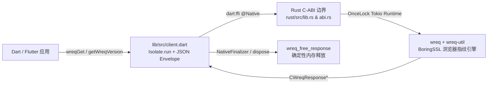

# wreq

跨平台 Dart & Flutter 原生 HTTP 与浏览器指纹模拟绑定库，底层基于 Rust 的 [`wreq`](https://crates.io/crates/wreq)（BoringSSL + HTTP/2 指纹模拟）并通过 Dart **Native Assets** 与 C-ABI 桥接。

## 核心特性

- **真实浏览器指纹模拟**：基于 `wreq 0.16.3` 与 `wreq-util 0.2.1`，内置主流浏览器的最新 TLS / HTTP2 指纹预设（Chrome 149、Safari iOS 26.2、Firefox 151）。
- **零阻塞异步调度**：Dart 侧通过 `Isolate.run` 派发请求，Rust 侧使用全局单例 Tokio 多线程运行时执行网络 I/O，不阻塞 Flutter UI 渲染线程。
- **Native Assets 自动化构建**：通过 `hook/build.dart` 与 `native_toolchain_rust` 自动编排 Cargo 编译与动态库绑定；针对 Android 交叉编译自动配置 NDK/BoringSSL 工具链并随包打包 `libc++_shared.so`。
- **确定性内存回收与异常安全**：`WreqResponse` 同时支持显式 `dispose()` 释放与 `NativeFinalizer` GC 兜底回收，并防止释放后读取；Rust C-ABI 边界捕获所有 `panic`，避免跨 FFI 崩溃。

## 架构概览



## 环境要求

- **Dart / Flutter SDK**：Dart SDK `^3.13.0`（启用 Native Assets 支持的 Flutter / Dart 环境）
- **Rust 工具链**：`rust/rust-toolchain.toml` 锁定 `1.98.0`，默认目标包含：
  - `x86_64-pc-windows-msvc`
  - `aarch64-linux-android`
  - `armv7-linux-androideabi`
  - `x86_64-linux-android`
- **原生构建依赖**：CMake、Ninja（构建钩子默认使用 `CMAKE_GENERATOR=Ninja`）、Clang / Perl / NASM（供 BoringSSL 编译使用）
- **Android 交叉编译**：需配置 `ANDROID_NDK_HOME`（或 `NDK_HOME` / `ANDROID_NDK_ROOT`）环境变量

## 安装

在项目的 `pubspec.yaml` 中通过 Git 依赖引入：

```yaml
dependencies:
  wreq:
    git:
      url: https://github.com/LelandMitchellx/wreq.git
```

本地开发调试时，也可以使用路径依赖：

```yaml
dependencies:
  wreq:
    path: ../wreq
```

## 快速开始

```dart
import 'package:wreq/wreq.dart';

Future<void> main() async {
  // 1. 查询底层原生库版本
  print('Native version: ${getWreqVersion()}');

  // 2. 发起带浏览器指纹模拟与自定义请求头的 GET 请求
  try {
    final response = await wreqGet(
      'https://pingly.us.kg/api/all',
      headers: {
        'X-Client': 'Wreq-Dart-Client',
      },
      timeout: const Duration(seconds: 15),
      emulation: EmulationProfile.chrome149,
    );

    try {
      print('Status: ${response.statusCode}');
      print('Body: ${response.body}');
    } finally {
      // 推荐在使用完毕后显式释放原生内存（未调用时也会由 NativeFinalizer 自动回收）
      response.dispose();
    }
  } on WreqException catch (e) {
    print('请求失败: ${e.message} (statusCode: ${e.statusCode})');
  }
}
```

## API 参考

### 函数

| 函数 | 说明 |
| --- | --- |
| `String getWreqVersion()` | 获取底层 Rust `wreq` 原生库版本号（例如 `wreq-0.16.3`）。 |
| `Future<WreqResponse> wreqGet(String url, {Map<String, String>? headers, Duration? timeout, EmulationProfile? emulation})` | 发起异步 HTTP GET 请求，支持自定义请求头、超时控制与浏览器指纹模拟。未指定 `emulation` 时，底层默认使用 `safariIos26_2`。 |
| `Future<String> runReadmeExample()` | 内置快捷示例函数，请求 `https://pingly.us.kg/api/all` 并返回响应正文。 |

### `EmulationProfile` 指纹预设

| 枚举值 | 对应浏览器指纹 |
| --- | --- |
| `EmulationProfile.chrome149` | Chrome 149 |
| `EmulationProfile.safariIos26_2` | Safari (iOS) 26.2（默认） |
| `EmulationProfile.firefox151` | Firefox 151 |

### `WreqResponse`

实现 `Finalizable` 的强类型响应对象：

- `int statusCode`：HTTP 状态码。
- `String body`：HTTP 响应正文；若对象已调用 `dispose()`，再次访问会抛出 `StateError`。
- `bool isDisposed`：底层原生内存是否已释放。
- `void dispose()`：幂等释放底层 Rust 分配的 `CWreqResponse` 内存，并解除 `NativeFinalizer` 绑定。

### `WreqException`

网络请求或 FFI 边界错误时抛出的异常：

- `String message`：错误描述信息。
- `int statusCode`：关联状态码，非 HTTP 状态错误时默认为 `-1`。

## 项目结构

```text
wreq/
├── hook/
│   └── build.dart           # Native Assets 构建钩子（Cargo 编译、BoringSSL 缓存复用、Android NDK 适配与 libc++_shared.so 打包）
├── lib/
│   ├── wreq.dart            # 包公共导出入口
│   └── src/
│       ├── bindings.dart    # dart:ffi @Native C-ABI 绑定与 NativeFinalizer
│       ├── client.dart      # 异步请求调度与公共函数实现
│       ├── exception.dart   # WreqException 异常定义
│       ├── profile.dart     # EmulationProfile 指纹枚举
│       └── response.dart    # WreqResponse 生命周期管理
├── rust/
│   ├── Cargo.toml           # Rust FFI Crate 配置（staticlib / cdylib）
│   ├── rust-toolchain.toml  # Rust 工具链与交叉编译目标锁定
│   └── src/
│       ├── lib.rs           # C-ABI 导出符号（wreq_version / wreq_request）与 Panic 防护
│       ├── abi.rs           # CWreqResponse 结构体与内存释放函数
│       ├── emulation.rs     # 浏览器指纹名称解析
│       ├── request.rs       # JSON 请求信封反序列化与 wreq 请求执行
│       └── runtime.rs       # 全局单例 Tokio 多线程运行时
├── example/                 # Flutter 交互式示例应用（支持切换指纹、编辑请求头并查看耗时与响应）
├── test/                    # 单元与集成测试
└── docs/                    # 架构决策记录（ADR）与项目文档
```

## 运行测试与示例

### 运行测试

```bash
flutter test
```

### 运行 Flutter 示例应用

```bash
cd example
flutter run
```

示例应用提供可视化界面，可实时查看原生库版本、输入目标 URL 与自定义请求头、切换浏览器指纹（Chrome 149 / Safari iOS 26.2 / Firefox 151）并展示响应状态码、耗时与正文。

## 相关文档

- 架构决策记录：[`docs/adr/0001-native-assets-c-abi-bridge.md`](docs/adr/0001-native-assets-c-abi-bridge.md)
- 术语表：[`GLOSSARY.md`](GLOSSARY.md)
